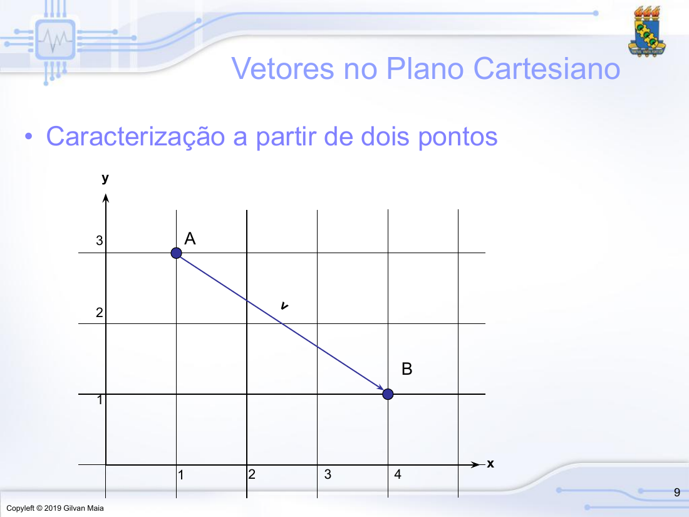
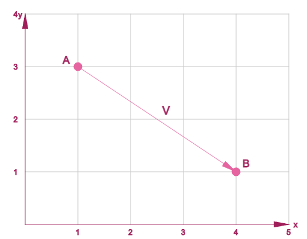

# Trabalho A0 — Reproduzir Figura com p5.js

Atividade da disciplina de Matemática e Física para Jogos de SMD - UFC
Docente: Gilvan Maia

## Objetivo
Reproduzir a figura apresentada em aula introdutória sobre vetores: um plano
cartesiano com grade, os pontos **A(1, 3)** e **B(4, 1)** e o vetor **v**, que vai
de A até B.

A regra da atividade é implementar o desenho por conta própria — sem usar
bibliotecas prontas para os cálculos. Por isso a conversão de coordenadas, a
grade (feita com laços `for`) e as setas (com a função `seta()`) são escritas
à mão.

### Figura a reproduzir (Slide 09)

> Imagem do Slide 09 da aula introdutória sobre vetores 

### Minha versão (feita em p5.js)

## Linguagem e ferramenta
- **Linguagem:** JavaScript
- **Biblioteca:** [p5.js](https://p5js.org) (desenho em canvas)

## Como executar
1. Acesse o editor online: https://editor.p5js.org
2. Apague o conteúdo da aba **sketch.js** e cole o código do arquivo `.txt`.
3. Clique em **Play (▶)**. A figura aparece no canvas.
